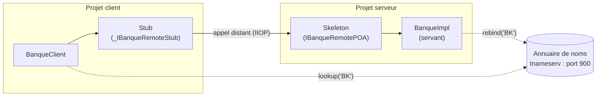
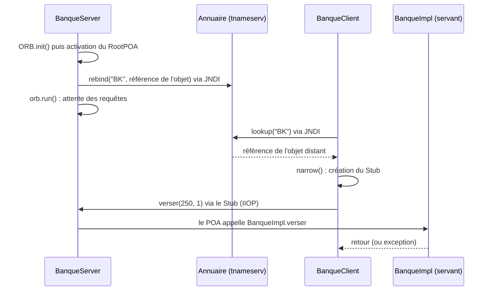
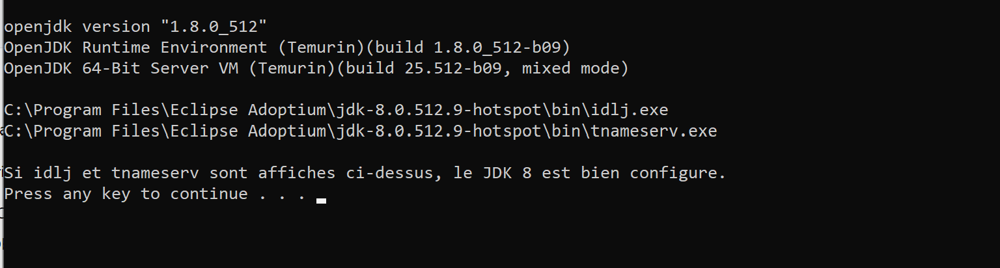
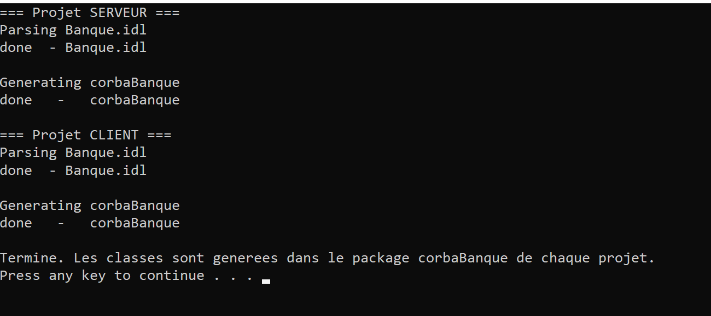
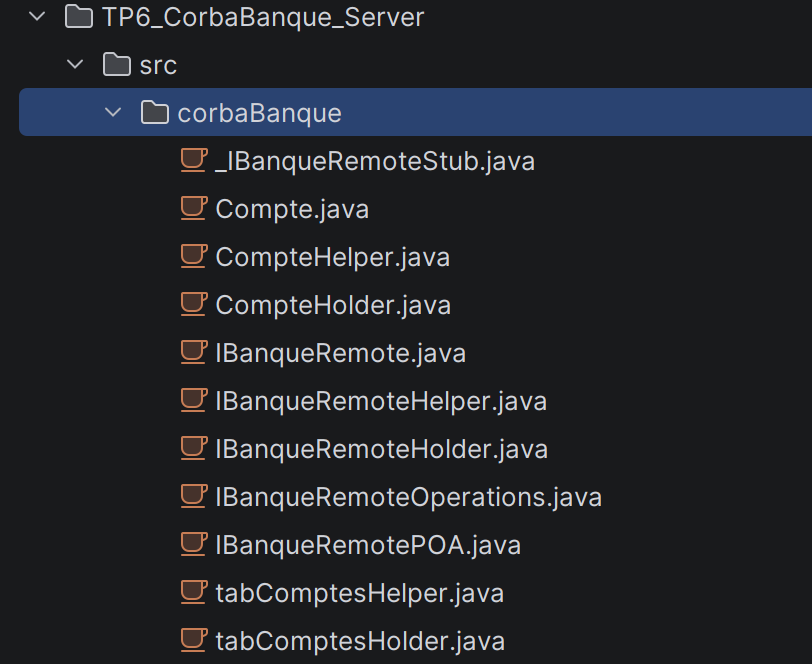
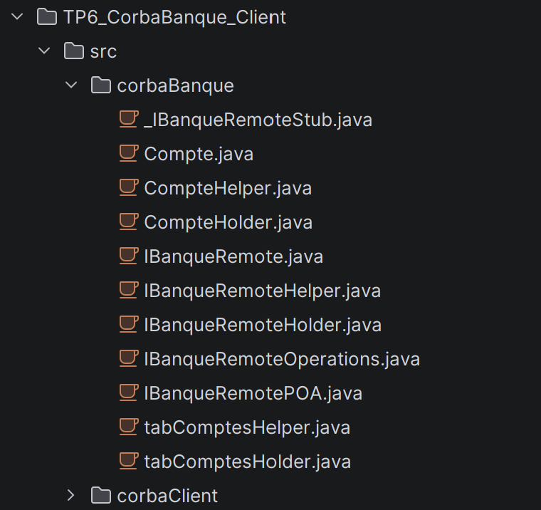
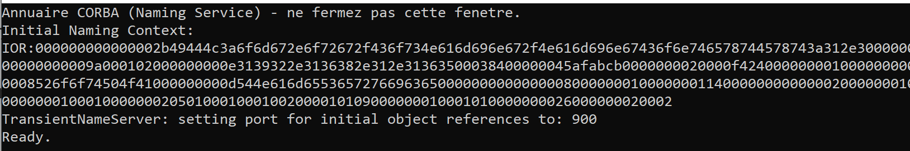
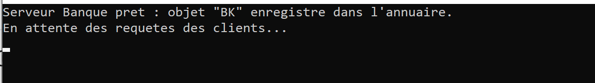
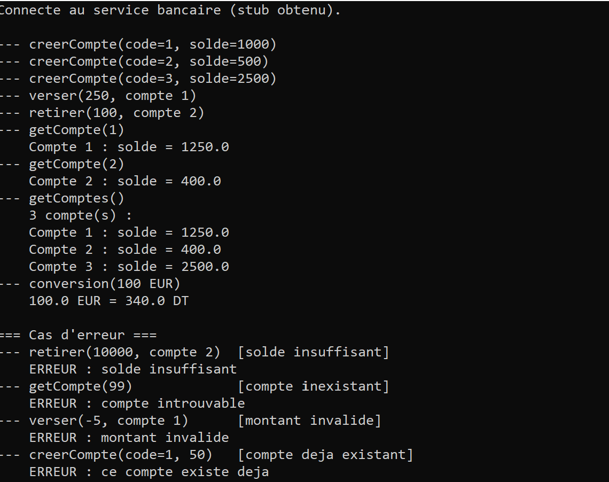
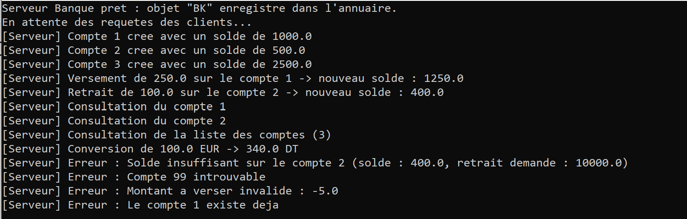

# TP 6 – Service Banque avec CORBA

**Matière :** Développement d'applications réparties  
**Filière :** LSI 3 – Faculté des Sciences de Sfax  
**Année universitaire :** 2026 – 2027  
**Responsable du cours :** Amal ABID  
**Enseignante des TPs :** Zeineb DAOUD  
**Type d'activité :** individuel  
**Réalisé par :** _(saidi rahma )_

---

## Sommaire

1. [Objectif](#1-objectif)
2. [Environnement](#2-environnement)
3. [Principe de CORBA et architecture](#3-principe-de-corba-et-architecture)
4. [Structure du dépôt](#4-structure-du-dépôt)
5. [Étape 1 : préparation de l'espace de travail](#5-étape-1--préparation-de-lespace-de-travail)
6. [Étape 2 : développement du serveur](#6-étape-2--développement-du-serveur)
7. [Étape 3 : développement du client](#7-étape-3--développement-du-client)
8. [Étape 4 : exécution de l'application](#8-étape-4--exécution-de-lapplication)
9. [Étape 5 : dépôt des livrables](#9-étape-5--dépôt-des-livrables)
10. [Problèmes courants et solutions](#10-problèmes-courants-et-solutions)
11. [Synthèse](#11-synthèse)

---

## 1. Objectif

Réaliser une **application répartie client-serveur en Java** avec le middleware **CORBA** (*Common Object Request Broker Architecture*). Un serveur gère l'ensemble des comptes bancaires. Chaque compte est défini par un **code** et un **solde**. Les clients peuvent, à distance :

| Opération | Méthode distante |
|---|---|
| Créer un compte avec une somme initiale | `creerCompte(Compte cpte)` |
| Verser une somme sur un compte (sachant son code) | `verser(float mt, int code)` |
| Retirer une somme d'un compte (sachant son code) | `retirer(float mt, int code)` |
| Consulter un compte (sachant son code) | `getCompte(int code)` |
| Consulter la liste de tous les comptes | `getComptes()` |
| Convertir un montant d'Euro (€) en Dinar Tunisien (DT) | `conversion(float mt)` |

---

## 2. Environnement

| Élément | Détail |
|---|---|
| JDK | **JDK 8** (obligatoire pour `idlj`, `tnameserv` et les classes `org.omg.*`) |
| IDE | Eclipse IDE for Java Developers, IntelliJ IDEA ou VS Code |
| Gestion de versions | Git / GitHub |
| Système | Windows |

> **Pourquoi le JDK 8 ?** Le module CORBA a été retiré du JDK à partir de la version 11. Les outils `idlj` (compilateur IDL) et `tnameserv` (annuaire de noms) ainsi que les paquets `org.omg.CORBA` n'existent donc que dans le JDK 8. Avec un JDK plus récent, la compilation de l'IDL est impossible.

Vérification de l'environnement : `java -version` doit afficher la version 1.8, et les commandes `idlj` et `tnameserv` doivent être reconnues (script `0_verifier_jdk.bat`).

---

## 3. Principe de CORBA et architecture

**CORBA** est un middleware normalisé par l'OMG qui permet à des objets écrits dans des langages différents, et situés sur des machines différentes, de communiquer comme s'ils étaient locaux. Le client appelle une méthode sur un **objet distant** sans connaître son emplacement ni son implémentation.

### 3.1 Composants

| Composant | Rôle dans ce TP |
|---|---|
| **IDL** (*Interface Definition Language*) | Décrit le contrat du service dans un fichier neutre : `Banque.idl` |
| **idlj** | Compilateur IDL → Java : génère les classes `Compte`, `IBanqueRemote`, le *Stub*, le *Skeleton (POA)*, les *Helpers* et *Holders* |
| **ORB** (*Object Request Broker*) | Bus de communication : achemine les appels entre client et serveur |
| **IIOP** | Protocole réseau utilisé par l'ORB (CORBA sur TCP/IP) |
| **Stub** (côté client) | Mandataire local : transforme l'appel de méthode en message réseau |
| **Skeleton / POA** (côté serveur) | Reçoit le message, le décode et appelle le servant |
| **POA** (*Portable Object Adapter*) | Adaptateur d'objets du serveur : gère le cycle de vie des servants |
| **Servant** | Classe qui implémente le service : `BanqueImpl` |
| **Naming Service** (`tnameserv`) | Annuaire de noms : associe un nom (`BK`) à la référence de l'objet distant |
| **JNDI** | API Java d'accès à l'annuaire (`jndi.properties`) |

### 3.2 Schéma d'architecture



### 3.3 Déroulement d'un appel



---

## 4. Structure du dépôt

```
NomPrenom_LSI3_DevAppReparties/
├── README.md
├── .gitignore
├── screen/                              (imprimés écran du README)
├── config_jdk.bat                       (chemin du JDK 8, à adapter)
├── 0_verifier_jdk.bat ... 5_lancer_client.bat   (scripts facultatifs)
├── TP6_CorbaBanque_Server/
│   └── src/
│       ├── Banque.idl                   (contrat du service)
│       ├── jndi.properties              (adresse de l'annuaire)
│       ├── corbaBanque/                 (généré par idlj)
│       ├── service/
│       │   └── BanqueImpl.java          (servant : code métier)
│       └── corbaServer/
│           └── BanqueServer.java        (serveur : ORB, POA, JNDI)
└── TP6_CorbaBanque_Client/
    └── src/
        ├── Banque.idl                   (copie du contrat)
        ├── jndi.properties              (copie)
        ├── corbaBanque/                 (généré par idlj)
        └── corbaClient/
            └── BanqueClient.java        (client : lookup, narrow, appels)
```

---

## 5. Étape 1 : préparation de l'espace de travail

1. Création du répertoire de travail `NomPrenom_LSI3_DevAppReparties`.
2. Lancement de l'IDE avec ce répertoire comme *workspace*.
3. Vérification du JDK : `java -version` et `idlj` dans l'invite de commandes.



**Synthèse :** l'espace de travail contient deux projets distincts (serveur et client), ce qui reflète la séparation réelle d'une application répartie. Le JDK 8 est indispensable pour utiliser `idlj` et `tnameserv`.

---

## 6. Étape 2 : développement du serveur

### 6.1 Projet et interface IDL

Création du projet Java **`TP6_CorbaBanque_Server`** et du fichier `src/Banque.idl` :

```idl
module corbaBanque {

    struct Compte {
        long code;
        float solde;
    };

    typedef sequence<Compte> tabComptes;

    interface IBanqueRemote {
        void creerCompte(in Compte cpte);
        void verser(in float mt, in long code);
        void retirer(in float mt, in long code);
        Compte getCompte(in long code);
        tabComptes getComptes();
        double conversion(in float mt);
    };
};
```

| Élément IDL | Rôle | Type Java généré |
|---|---|---|
| `module corbaBanque` | Espace de noms | package `corbaBanque` |
| `struct Compte` | Un compte (code, solde) | classe `Compte` (champs publics `code`, `solde`) |
| `typedef sequence<Compte> tabComptes` | Tableau de comptes | `Compte[]` |
| `interface IBanqueRemote` | Contrat du service distant | `IBanqueRemote`, `IBanqueRemoteOperations` |
| `in` | Paramètre passé en entrée | paramètre Java classique |

### 6.2 Compilation de l'IDL

Dans le répertoire `src` du projet serveur :

```
idlj -fall -v Banque.idl
```

L'option `-fall` génère le code client **et** serveur, `-v` affiche les fichiers produits. Après un *refresh* du projet, le package `corbaBanque` contient :

| Fichier généré | Rôle |
|---|---|
| `Compte.java` | Structure `Compte` |
| `CompteHelper.java`, `CompteHolder.java` | Outils de (dé)sérialisation et passage par référence |
| `IBanqueRemote.java` | Interface Java du service |
| `IBanqueRemoteOperations.java` | Les méthodes distantes |
| `IBanqueRemoteHelper.java` | Méthode `narrow()` : conversion de la référence en Stub |
| `IBanqueRemoteHolder.java` | Passage par référence |
| `_IBanqueRemoteStub.java` | **Stub** utilisé par le client |
| `IBanqueRemotePOA.java` | **Skeleton** dont hérite le servant |
| `tabComptesHelper.java`, `tabComptesHolder.java` | Outils pour le tableau de comptes |





### 6.3 Implémentation du servant : `service.BanqueImpl`

La classe `BanqueImpl` **hérite de `IBanqueRemotePOA`** et implémente toutes les méthodes de `IBanqueRemoteOperations`. Les comptes sont stockés en mémoire dans une `TreeMap<Integer, Compte>` (triée par code).

| Méthode | Comportement |
|---|---|
| `creerCompte` | Ajoute le compte ; erreur s'il existe déjà ou si le solde est négatif |
| `verser` | Ajoute le montant au solde ; erreur si le compte est inconnu ou le montant ≤ 0 |
| `retirer` | Retire le montant ; erreur si le compte est inconnu, le montant ≤ 0 ou le solde insuffisant |
| `getCompte` | Renvoie (une copie de) le compte ; erreur s'il n'existe pas |
| `getComptes` | Renvoie le tableau de tous les comptes |
| `conversion` | Retourne `mt × 3,40` (taux fixe 1 € = 3,40 DT) |

**Gestion des erreurs.** L'IDL imposé par le TP ne déclare pas d'exceptions utilisateur. Les erreurs métier sont donc signalées par une exception CORBA standard `BAD_PARAM`, dont le **code mineur** (`minor`) précise la cause. Le client le traduit en message lisible :

| Code mineur | Cause |
|---|---|
| 1 | Compte déjà existant |
| 2 | Compte introuvable |
| 3 | Montant invalide |
| 4 | Solde insuffisant |

Les méthodes modifiant les comptes sont `synchronized`, car plusieurs clients peuvent appeler le serveur en même temps.

### 6.4 Configuration JNDI

Fichier `src/jndi.properties` :

```
java.naming.factory.initial = com.sun.jndi.cosnaming.CNCtxFactory
java.naming.provider.url = iiop://localhost:900
```

La première ligne choisit la fabrique JNDI pour l'annuaire CORBA ; la seconde indique son adresse (hôte `localhost`, port `900`, port par défaut de `tnameserv`).

### 6.5 Le serveur : `corbaServer.BanqueServer`

La méthode `main` suit les étapes demandées :

```java
ORB orb = ORB.init(args, null);                                        // a. ORB
POA rootPOA = POAHelper.narrow(orb.resolve_initial_references("RootPOA"));
rootPOA.the_POAManager().activate();                                   // b. POA

Hashtable<String, Object> env = new Hashtable<String, Object>();
env.put("java.naming.corba.orb", orb);
Context ctx = new InitialContext(env);                                 // c. JNDI

BanqueImpl servant = new BanqueImpl();                                 // d. servant

org.omg.CORBA.Object reference = rootPOA.servant_to_reference(servant);
ctx.rebind("BK", reference);                                           // e. enregistrement

orb.run();                                                             // f. attente des requêtes
```

**Synthèse :** le serveur ne contient aucun code réseau. L'ORB et le POA s'occupent de la communication, et le code métier reste isolé dans `BanqueImpl`. Le nom `BK` est la clé que le client utilisera pour retrouver l'objet.

---

## 7. Étape 3 : développement du client

1. Création du projet **`TP6_CorbaBanque_Client`**.
2. Copie de `Banque.idl` et `jndi.properties` dans `TP6_CorbaBanque_Client/src`.
3. Nouvelle compilation de l'IDL dans le projet client : `idlj -fall -v Banque.idl`.
4. Création de la classe `corbaClient.BanqueClient`.



Le client suit les étapes demandées :

```java
Context ctx = new InitialContext();                                    // a. propriétés JNDI
org.omg.CORBA.Object reference =
        (org.omg.CORBA.Object) ctx.lookup("BK");                       // b. référence distante
IBanqueRemote banque = IBanqueRemoteHelper.narrow(reference);          // c. narrow -> Stub

banque.creerCompte(new Compte(1, 1000f));                              // d. appels distants
banque.verser(250f, 1);
```

La méthode `narrow()` de `IBanqueRemoteHelper` convertit la référence générique en un **Stub** typé `IBanqueRemote`. Ensuite, appeler `banque.verser(...)` ressemble à un appel local, alors que l'appel traverse le réseau.

Le client **teste chaque méthode** : création de trois comptes, versement, retrait, consultation d'un compte, liste des comptes, conversion, puis quatre **cas d'erreur volontaires** (solde insuffisant, compte inexistant, montant invalide, compte déjà existant).

**Synthèse :** le client ne connaît que le contrat IDL (classes générées) et le nom `BK`. Il ignore tout de l'emplacement et de l'implémentation du serveur, ce qui illustre la **transparence de localisation** de CORBA.

---

## 8. Étape 4 : exécution de l'application

L'ordre d'initialisation doit être respecté : **annuaire → serveur → client**.

### 8.1 Lancer l'annuaire (Naming Service)

Dans le dossier du projet serveur :

```
tnameserv
```

(ou `tnameserv -ORBInitialPort 900`). Ne pas fermer cette fenêtre.



### 8.2 Lancer le serveur

Exécuter la classe `corbaServer.BanqueServer`. Message attendu :

```
Serveur Banque pret : objet "BK" enregistre dans l'annuaire.
En attente des requetes des clients...
```



### 8.3 Lancer le client

Exécuter la classe `corbaClient.BanqueClient`. Sortie attendue (aux valeurs affichées près) :

```
Connecte au service bancaire (stub obtenu).

--- creerCompte(code=1, solde=1000)
--- creerCompte(code=2, solde=500)
--- creerCompte(code=3, solde=2500)
--- verser(250, compte 1)
--- retirer(100, compte 2)
--- getCompte(1)
    Compte 1 : solde = 1250.0
--- getCompte(2)
    Compte 2 : solde = 400.0
--- getComptes()
    3 compte(s) :
    Compte 1 : solde = 1250.0
    Compte 2 : solde = 400.0
    Compte 3 : solde = 2500.0
--- conversion(100 EUR)
    100.0 EUR = 340.0 DT

=== Cas d'erreur ===
--- retirer(10000, compte 2)  [solde insuffisant]
    ERREUR : solde insuffisant
--- getCompte(99)             [compte inexistant]
    ERREUR : compte introuvable
--- verser(-5, compte 1)      [montant invalide]
    ERREUR : montant invalide
--- creerCompte(code=1, 50)   [compte deja existant]
    ERREUR : ce compte existe deja
```



Côté serveur, chaque appel laisse une trace dans la console (création, versement, retrait, conversion, erreurs) :



> **Remarque :** les comptes sont gardés en mémoire. Si le client est relancé sans redémarrer le serveur, les créations de comptes échouent avec « ce compte existe déjà » : c'est le comportement attendu.

### 8.4 Exécution avec les scripts (facultatif)

Les scripts `.bat` à la racine permettent de tout faire sans IDE. Après avoir adapté le chemin du JDK 8 dans `config_jdk.bat` :

| Script | Action |
|---|---|
| `0_verifier_jdk.bat` | Vérifie la version de Java et la présence de `idlj` / `tnameserv` |
| `1_generer_idl.bat` | Compile `Banque.idl` dans les deux projets |
| `2_compiler.bat` | Compile le serveur et le client |
| `3_lancer_annuaire.bat` | Lance l'annuaire (port 900) |
| `4_lancer_serveur.bat` | Lance le serveur |
| `5_lancer_client.bat` | Lance le client |

---

## 9. Étape 5 : dépôt des livrables

```
git init
git add .
git commit -m "TP6 CORBA - Service Banque"
git branch -M main
git remote add origin <lien-du-depot>
git push -u origin main
```


---

## 10. Problèmes courants et solutions

| Problème | Cause | Solution |
|---|---|---|
| `idlj` ou `tnameserv` « n'est pas reconnu » | JDK 11 ou plus récent, ou `PATH` mal configuré | Installer un **JDK 8** et ajouter son dossier `bin` au `PATH` (ou adapter `config_jdk.bat`) |
| `package org.omg.CORBA does not exist` | Projet compilé avec un JDK sans CORBA | Choisir le JDK 8 comme JRE du projet |
| `cannot find symbol : IBanqueRemotePOA` | L'IDL n'a pas été compilé, ou le projet n'a pas été rafraîchi | Lancer `idlj -fall -v Banque.idl` dans `src`, puis *Refresh* |
| `NoInitialContextException` | `jndi.properties` introuvable dans le *classpath* | Placer le fichier dans `src` (copié automatiquement dans `bin`) |
| `CommunicationException` / `COMM_FAILURE` à la connexion | Annuaire non lancé, ou serveur absent | Respecter l'ordre : `tnameserv` → serveur → client |
| `Address already in use` au lancement de `tnameserv` | Le port 900 est déjà utilisé (annuaire déjà lancé) | Fermer l'ancien annuaire ou changer le port (et l'URL dans `jndi.properties`) |
| `NameNotFoundException: BK` | Le serveur n'a pas enregistré l'objet | Relancer le serveur après l'annuaire |
| Erreur « ce compte existe déjà » au 2ᵉ lancement du client | Les comptes restent en mémoire dans le serveur | Redémarrer le serveur |

---

## 11. Synthèse

Ce TP a permis de réaliser une application répartie complète avec CORBA :

- **Contrat d'abord** : l'interface est écrite une seule fois en IDL (`Banque.idl`), puis `idlj` génère automatiquement tout le code d'infrastructure (Stub, Skeleton, Helpers) pour le client et le serveur.
- **Séparation des rôles** : le servant `BanqueImpl` ne contient que le code métier ; l'ORB, le POA et l'annuaire s'occupent de la communication.
- **Transparence de localisation** : le client retrouve l'objet par son nom (`BK`) via JNDI et l'appelle comme un objet local grâce au Stub.
- **Ordre de démarrage** : l'annuaire doit exister avant le serveur (qui y publie sa référence), et le serveur avant le client (qui la consulte).
- **Limites rencontrées** : CORBA exige un JDK 8, et l'IDL imposé ne prévoit pas d'exceptions utilisateur, d'où l'usage du code mineur d'une exception système pour signaler les erreurs métier.

**Comparaison avec REST (TP 3).** CORBA repose sur un contrat IDL strict, un protocole binaire (IIOP) et un annuaire de noms ; il est performant et fortement typé, mais plus lourd à mettre en place. REST, basé sur HTTP et JSON, est plus simple et plus répandu pour les API ouvertes. Les deux approches illustrent le même principe : appeler un service distant sans connaître son implémentation.
